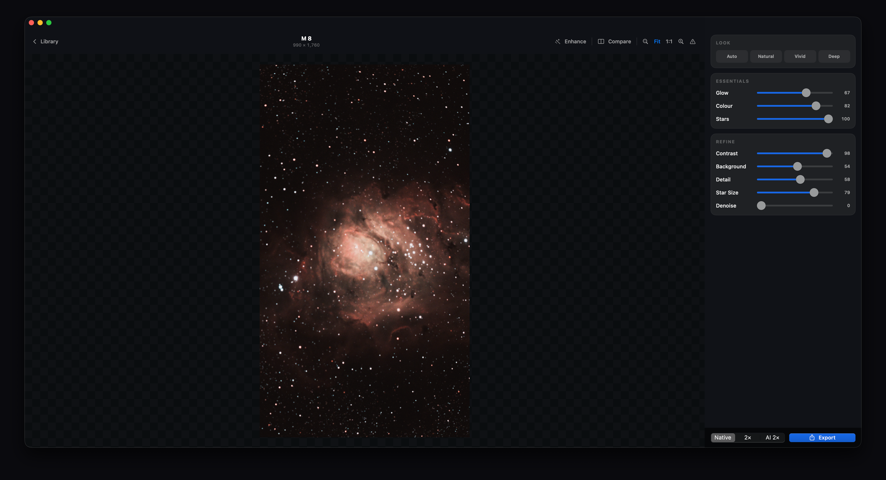

# Nebula

**Deep-sky, done for you.** Nebula is a macOS app that turns a folder of
[Seestar](https://www.seestar.com) telescope sub-frames into a finished deep-sky
image with one tap — then lets you refine it with eleven plain-language sliders
that respond instantly, at up to 120 fps. It looks and feels like a photo app,
not a telescope tool.



- **Platform:** macOS 26+, Apple Silicon
- **UI:** SwiftUI · **Interactive core:** native Metal · **AI:** in-process onnxruntime · **Classical DSP:** bundled headless [Siril](https://siril.org)
- **Licence:** [GPL-3.0](LICENSE) · third-party attributions in [NOTICES.md](NOTICES.md)

## Install (users)

1. Download `Nebula.dmg` from the [latest release](../../releases/latest) and
   drag **Nebula** to Applications.
2. Open it. If macOS says it can't verify Nebula (a build that isn't notarised
   yet), open it once, then go to **System Settings → Privacy & Security** and
   click **Open Anyway** — right-click → Open no longer bypasses this on
   macOS 15 and later.
3. For the best results, install [GraXpert](https://graxpert.com) (free, open
   source) and open it once so it fetches its AI models — Nebula finds and uses
   them automatically for sky-gradient removal and denoising. Nebula develops
   images without them too, at reduced quality, and will offer this step the
   first time it needs it.
4. Drop a Seestar `…_sub` folder onto the window. That's it.

Everything else is self-contained: Siril and the Metal engine ship inside the
app — no Homebrew, no Python, no external tools.

## What it does

- **One-tap develop:** register → stack → colour-calibrate (Siril, bundled) →
  AI sky-gradient removal + denoise (GraXpert's open models via onnxruntime,
  in-process) → star separation → five float image layers, cached per
  target so re-opening is instant.
- **Instant editing:** Glow, Saturation, Vibrance, Tint, Warmth and Stars up
  front; Contrast, Background, Detail, Star Size and Denoise under Refine.
  Star Size is bidirectional — below the midpoint it *tightens* bloated stars
  (morphological reduction on the real star flux), above it adds bloom. Every
  target opens on a developed look that Reset returns to; before/after wipe,
  clipping view.
- **Preview == export.** The same GPU shader chain renders the live view and
  the 16-bit PNG export. What you see is exactly what you save. Optional AI 2×
  enlargement (Real-ESRGAN) on export.
- **Library & watch mode:** a grid of everything you've developed; point watch
  mode at your Seestar folder and new targets develop themselves and notify you.

## Architecture — bake once, play forever

```
IMPORT  <Target>_sub folder
   │
   ▼  STAGE A · BAKE  (headless, cached, once per target)
   Siril: select compatible lights → register → stack → colour calibration
   onnxruntime (in-process): background extraction → denoise
   star separation (user-installed StarNet if present, else classical mask)
   → five float FITS layers: master · corrected · denoised · starless · stars
   → manifest.json (typed bake↔play contract, saved look, stage outcomes)
   │
   ▼  STAGE B · PLAY  (native Metal, ~120 Hz)
   shader chain over the resident layers → live preview == 16-bit export
```

Stage A runs the science once. Stage B is pure GPU — dragging sliders never
re-runs Siril or the AI, which is why it can be both faithful and instant.
Every bake stage has a graceful fallback (recorded in the manifest), so the
user always lands on an image.

## Repository layout

| Path | What it is |
|------|------------|
| `Sources/NebulaCore` | Pure, tested core: `LookState` (11 floats), sliders/profiles, `EngineParams` (slider→shader mapping), `Manifest` |
| `Sources/NebulaEngine` | Metal engine: `ChainRenderer`, shaders, float-FITS read/write |
| `Sources/NebulaAI` | In-process AI via onnxruntime: denoise, background extraction, super-resolution |
| `Sources/NebulaBake` | Native bake orchestrator: Siril stage, AI stages, star separation, fallbacks |
| `Sources/NebulaApp` | The SwiftUI app: Library, baking progress, editor, watch mode |
| `Sources/NebulaRender` | `nebula-render` — headless CLI export (same chain, no UI) |
| `Sources/NebulaBakeCLI` | `nebula-bake-native` — run a bake from the CLI |
| `Sources/NebulaAICLI` | `nebula-ai` — FITS-in/out denoise/bg CLI |
| `prototype/` | Phase-0 Python reference (dev-only, never shipped) |

Deeper docs: [`CLAUDE.md`](CLAUDE.md) (contributor quick-start: build/run,
invariants, gotchas), [`seestar-autoprocess-design.md`](seestar-autoprocess-design.md)
(design of record), [`HANDOFF.md`](HANDOFF.md) (status log).

## Build from source (developers)

Prerequisites: Apple Silicon, full Xcode 16+ (Swift 6; the Command Line Tools
alone lack the SwiftUI macros), and for app packaging
`brew install siril dylibbundler`. The package builds and tests on macOS 14+;
the packaged app requires the macOS its bundled Homebrew Siril was built for
(currently 26).

```bash
# Build + test (use an out-of-tree scratch path; see note below)
scripts/swift-xcode.sh build --scratch-path /tmp/nebula-build
scripts/swift-xcode.sh test  --scratch-path /tmp/nebula-build

# Run the app
scripts/swift-xcode.sh build --product NebulaApp --scratch-path /tmp/nebula-build
/tmp/nebula-build/debug/NebulaApp                # or: NebulaApp <subs folder>

# Package a self-contained app + DMG (bundles Siril + licence texts)
scripts/build-app.sh      # → build/Nebula.app (ad-hoc signed unless NEBULA_SIGN_ID is set)
scripts/build-dmg.sh      # → build/Nebula.dmg
```

Signing, notarisation and the per-release source archive are covered in
[`docs/RELEASING.md`](docs/RELEASING.md).

> **Note:** if this repo lives under a synced folder (Dropbox/iCloud), the file
> provider can break codesigning inside `.build` — always pass a scratch path
> outside the synced folder, as above.

AI models for development are discovered from GraXpert's cache
(`~/Library/Application Support/GraXpert/…`) or `~/Library/Application
Support/Nebula/Models/`, or via `NEBULA_BGE_MODEL` / `NEBULA_DENOISE_MODEL`.
A user-installed `starnet2` CLI is picked up automatically from
`/usr/local/bin`, `/opt/homebrew/bin` or `/usr/bin`; any other star remover can
be plugged in with `NEBULA_STARNET='cmd {input} {output}'`. Without one, a
classical star mask keeps the star controls functional.

## Licensing & models

Nebula is GPL-3.0. It bundles Siril (GPL-3.0) with its Homebrew library
closure, links onnxruntime (MIT), and ships a Real-ESRGAN x2 model
(BSD-3-Clause) converted reproducibly by `scripts/convert-realesrgan-x2.py`.
Every licence text ships in the app and the DMG; each release carries the
source archives for the bundled binaries. GraXpert's AI models are **not**
redistributed — Nebula uses the copies GraXpert itself installs. StarNet is
**not** bundled (its licence is non-commercial); it is used only if you
install it. Full inventory and source offer: [NOTICES.md](NOTICES.md).

Contributions welcome — see [CONTRIBUTING.md](CONTRIBUTING.md).
